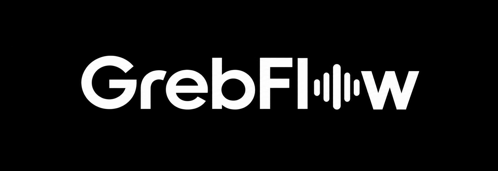
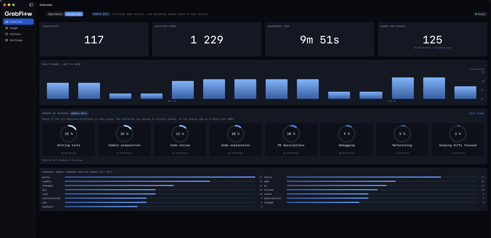

**Talk to your AI coding tools. Then see what you keep asking them.**

A macOS app for developers. Hold a key, speak, let go, and the text is pasted wherever you're typing.

<!-- Hero screenshot: dashboard overview -->
<!--  -->

---

## Why

We spend more and more of the day telling AI agents what to do in plain English, and speaking is faster than typing. We also repeat the same instructions every day. Those are the ones worth turning into a skill or a shared prompt, but nobody sees them once they scroll out of the chat.

## Dictation

Hold **right Option**, speak, release. GrebFlow pastes the text as one line and never presses Enter, so it's safe in a terminal or Claude Code.

<!--  -->

Speech recognition runs on your Mac. Apple's recognizer is the default and needs no download. Switch to Whisper in Settings and developer words come out right, so you get `JSON` instead of "Jason".

## Usage insights

The dashboard shows how much you dictate and which words and phrases you repeat. Claude then groups your requests by meaning. "Use conventional commits" and "include a subject and body" both land under Commit preparation, with the exact excerpts that put them there. It updates in the background, so there's no button to press.

<!--  -->

If "Writing tests" shows up 40 times in two weeks, you know which skill to write next.

## Privacy

Audio stays on your Mac and is never saved. History lives in a local database. Claude only sees new transcripts, and only after you turn grouping on. It uses Claude Haiku with a daily spending cap.

## What's next

- Turn a group into a draft skill or prompt you can review and share
- Rolling 7 or 30 day history
- Mute speakers while recording
- Swedish

## Built in a day

We made GrebFlow at a Grebban hackday. We wrote one spec together, had three AI agents build it in parallel, and kept the best version. The specs are in [`plans/`](plans/).

Built with Swift 6, SwiftUI, SwiftData, Apple's SpeechAnalyzer, WhisperKit and the Anthropic API, for macOS 26 on Apple silicon.
